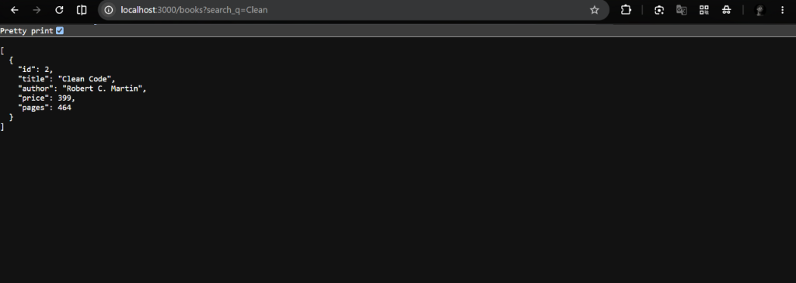
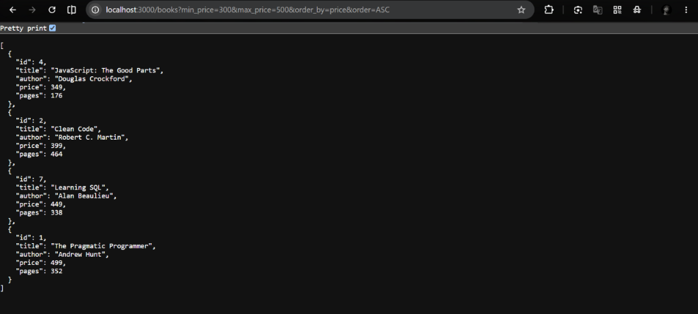
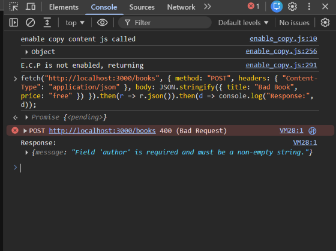
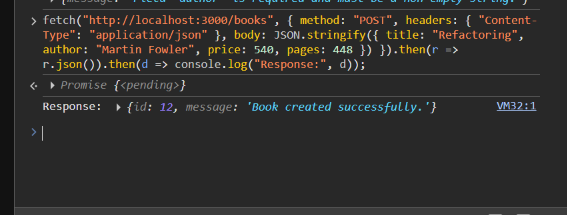
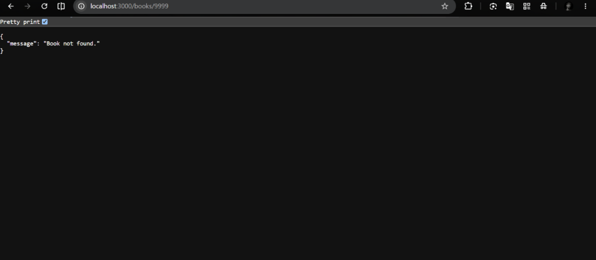

# Lab 3: REST API, Query Parameters, Validation, and Debugging

**Course:** Backend Development Fundamentals · Year II Term II · Aurora  
**Faculty:** Joel Prashanth D / Chintakrindi Sai Siva Teja  

---

**Name:** Anudeep panakanti  
**Registration Number:** 214  
**Section:** 214 CSE-2D  

---

## 🌐 Live Link

> Not deployed yet — test verification screenshots are provided in the `screenshots/` folder below.

---

## 📦 How to Run

### Prerequisites
- Node.js v18 or later
- npm (bundled with Node.js)

### Install & Start

```bash
# 1. Navigate to lab-03 folder
cd lab-03

# 2. Install dependencies
npm install

# 3. Start development server with nodemon
npm run dev

# OR start with regular node
npm start
```

The server starts on **http://localhost:3000** by default and automatically creates and seeds `books.db` on first run.

### Environment Variables

| Variable | Description | Example |
|----------|-------------|---------|
| `PORT` | Port number the server listens on | `3000` |

---

## 🗺️ REST API Endpoints

| Method | Path | Description | Status Code |
|--------|------|-------------|-------------|
| GET | `/books` | Get books with search, filters, sorting, and pagination | 200, 400 |
| GET | `/books/:bookId` | Get a single book by id | 200, 404 |
| POST | `/books` | Add a new book (with request body validation) | 201, 400 |
| PUT | `/books/:bookId` | Update an existing book by id | 200, 400, 404 |
| DELETE | `/books/:bookId` | Remove a book by id | 200, 404 |

### Query Parameters for `GET /books`

| Parameter | Type | Default | Description |
|-----------|------|---------|-------------|
| `search_q` | string | `""` | Partial case-insensitive title search via `LIKE %search_q%` |
| `order_by` | string | `id` | Column to sort by (`id`, `title`, `price`, `pages`, `author`) |
| `order` | string | `ASC` | Sort order (`ASC` or `DESC`) |
| `limit` | integer | `10` | Maximum number of books to retrieve |
| `offset` | integer | `0` | Number of books to skip |
| `min_price` | number | - | Filter books with price greater than or equal to `min_price` |
| `max_price` | number | - | Filter books with price less than or equal to `max_price` |

---

## 🛠️ Debugging Exercise (Task 7)

| Error Encountered | Root Cause | Solution Applied |
|-------------------|------------|------------------|
| `EADDRINUSE: address already in use :::3000` | Another process is already running on port 3000. | Kill the existing process occupying port 3000, or configure the server to use an alternate port using `process.env.PORT || 3001`. |
| `Cannot find module './...'` (Wrong import path) | File path in `require()` was misspelled or referenced the wrong relative directory. | Corrected the relative import path (e.g. `path.join(__dirname, 'books.db')`). |
| `SQLITE_ERROR: no such table` | Typo in the SQL query table name (e.g., `books` instead of `book`), or table creation ran after queries. | Corrected table name to `book` and placed `CREATE TABLE IF NOT EXISTS` inside `initializeDBAndServer` before listening. |
| Missing `await` keyword | Database query executed asynchronously without `await`, returning an unresolved Promise instead of rows. | Added `await` before asynchronous DB operations: `await db.all(...)`, `await db.get(...)`, `await db.run(...)`. |

---

## ❓ Viva Answers

**Q: Query parameter vs Path parameter?**  
- **Path parameter** (e.g. `/books/:bookId` &rarr; `/books/3`): Used to identify a specific, unique resource.  
- **Query parameter** (e.g. `/books?order_by=price&limit=5`): Used to filter, search, sort, or paginate a collection without changing which resource is targeted.

**Q: What does stateless mean in REST?**  
Statelessness means that every request from the client to the server must contain all the information necessary to understand and process the request. The server does not store any client session state between requests.

**Q: Which status code for bad input vs a missing record?**  
- **`400 Bad Request`**: Used when the client sends malformed, invalid, or missing input data (e.g. non-numeric price or missing title).  
- **`404 Not Found`**: Used when the input format is valid, but the requested resource does not exist in the database (e.g. `/books/9999`).

---

## 📸 Screenshots

### 1. GET `/books` with Search (`search_q=Clean`)


### 2. GET `/books` with Price Filter & Sort (`min_price=300&max_price=500&order_by=price&order=ASC`)


### 3. POST `/books` with Validation Error (400 Bad Request)


### 4. POST `/books` Successful Creation (201 Created)


### 5. GET `/books/9999` Non-existent ID (404 Not Found)

